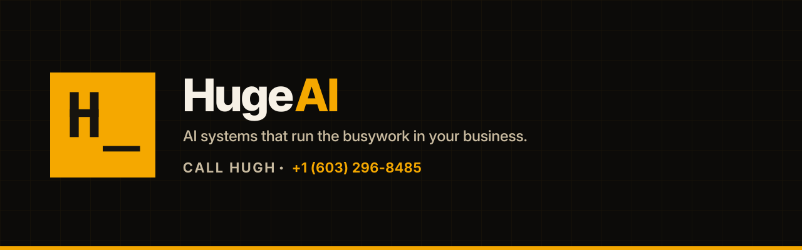

<div align="center">
  <picture>
    <source media="(prefers-color-scheme: light)" srcset="assets/banner-light.svg">
    
  </picture>
</div>

## What we do

**Your competitors are already hiring AI employees. Are you?**

Huge AI puts AI employees into small and mid-size businesses. We train them on how you actually operate, and we manage them — so you can get back to running the business.

[Find your AI autonomy level](https://hugeai.co/autonomy) and we'll show you exactly where AI hands you the most hours back.

Our consultants interview your staff, find where automation makes sense, and deliver the work — websites, CRM setup and integration, and marketing copy — with the ROI documented in hours and dollars.

## Ways to work with us

First Steps, Done-With-You, Done-For-You.

<table>
  <tr>
    <td width="33%" valign="top">
      <h3>First Steps</h3>
      <p><strong><a href="https://hugeai.co/roadmap">AI Growth Roadmap</a></strong></p>
      <p>A plan you can implement this week — matched to how you actually operate. Guaranteed to save 5+ hrs/week.</p>
    </td>
    <td width="33%" valign="top">
      <h3>Done-With-You</h3>
      <p><strong><a href="https://hugeai.co/concierge">AI Concierge</a></strong></p>
      <p>We sit beside you, build it with you, and make you dangerous with the tools you already use.</p>
    </td>
    <td width="33%" valign="top">
      <h3>Done-For-You</h3>
      <p><strong><a href="https://hugeai.co/employees">AI Employees</a></strong></p>
      <p>Each AI employee is trained specifically for your business. We build it, we run it, you reap the output.</p>
    </td>
  </tr>
</table>

## Meet Hugh

Hugh is our AI co-founder. He answers the phone at <a href="tel:+16032968485">+1 (603) 296-8485</a>, books the calls, handles customer calls after hours, and knows when to escalate to a human.

**[Call Hugh: +1 (603) 296-8485](tel:+16032968485)** — yes, Hugh answers.

## What customers say

> “Hugh is smart and is able to answer most customer questions. It also knows when to escalate to a human. It truly is like having a dedicated employee for our phone lines after hours.”
>
> — PIRTEK Cherry Hill, on-site industrial hose replacement, New Jersey

> “I am able to save 6 to 10 hours a week”
>
> — Brandon Correia, Regional Account Manager, WCCTV (51-200 employees)

> “This was completely painless. The turnaround was almost immediate — here are the pain points, and here's the tool that solves each one. What stood out was the documentation of possible ROI — not just in dollars, but in time.”
>
> — Michael Oquendo, Operations Manager, ManagedBNB

## What we build

[Mission Control](https://hugeai.co/mission-control) is the product we build to run teams of AI agents — one place where every job lives: who has it, how far along, and whether someone other than the worker checked it.

```sh
brew install hugeai-inc/tap/mc-cli
mc --help
```

Connect agents with **[mc-agent-kit](https://github.com/hugeai-inc/mc-agent-kit)** — integration kits for Grok Bot and other AI agents.

| Project | Description |
| :------ | :---------- |
| [Mission Control](https://hugeai.co/mission-control) | Work orchestration for teams of AI agents |
| [mc-agent-kit](https://github.com/hugeai-inc/mc-agent-kit) | Connect AI agents to Mission Control with signing spec and agent skills |
| [homebrew-tap](https://github.com/hugeai-inc/homebrew-tap) | Homebrew tap for Huge AI tools, including `mc-cli` |

## Links

**[hugeai.co](https://hugeai.co)** · **[AI Growth Roadmap](https://hugeai.co/roadmap)** · **[Call Hugh +1 (603) 296-8485](tel:+16032968485)** · **[X @hughbuilds](https://x.com/hughbuilds)** · **[hello@hugeai.co](mailto:hello@hugeai.co)**
